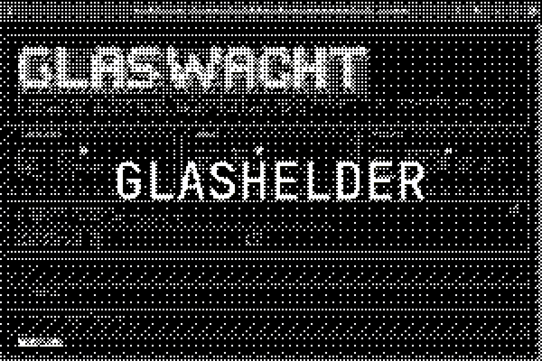

# Glashelder AI Experiments



<p align="center">
  <a href="https://github.com/GhentCDH/glashelder/actions/workflows/ci.yml"></a>
  <a href="https://github.com/astral-sh/uv"></a>
  
</p>

This repository contains many different experiments for _intelligently automating_ a metadata extraction pipeline
for scanned historical glass plate photographs.

It contains the following functionality:

- [preprocessing](preprocessing/) images
  - cropping using trained YOLO model

- [generating embedding vectors](embed/) of images (and image descriptions)
  - CLIP
  - DINOv2 (no text support)

- [clustering](cluster/) the embeddings
  - [rerun](https://rerun.io) 3d visualization of clustered point cloud
  - hierarchical re-clustering of large clusters

- [risk assessment](glaswacht/)
  - running multiple VLM Guard models with majority voting to assess the 'safety' of images

- [artwork matching](artmatcher/)
  - given a dataset of 'known' artworks, find glass plates that contain any of them

Shared utilities live in [common](common/).

## Prerequisites

### Hardware

The risk assessment functionality requires running large transformer models, which is only feasible
on a powerful GPU. However, all other experiments also benefit from having a good GPU.

Please refer to the workspace's own README files to see their recommended hardware.

Recently, many core Python AI packages have dropped support for MacOS computers with Intel CPUs.
Therefore, this project also doesn't have support for these machines.
Most other Linux, Windows or MacOS (with apple silicon) systems should be supported.

**NVIDIA GPU (CUDA)**

If you have a Nvidia CUDA GPU on your system, this repository should be plug-and-play.
When you encounter any CUDA-related issues, chances are your GPU drivers are out of date.
This repository supports `> CUDA 12.6` out of the box.
However, if you have older drivers (e.g. `11.8`), you should be able to edit this table in `pyproject.toml`:

```diff
[[tool.uv.index]]
name = "pytorch"
- url = "https://download.pytorch.org/whl/cu126"
+ url = "https://download.pytorch.org/whl/cu118"
explicit = true
```

**Apple Silicon (MPS)**

Any Apple Silicon computer chip has support for MPS, which pytorch has support for.
Your system should be plug-and-play with GPU support for these experiments.

**No GPU (CPU)**

Many of the experiments will run, but very slowly.

### Software

This project uses the [`uv`](https://docs.astral.sh/uv/) python package manager in order to
make sure that everyone uses the same compatible packages when running this code.

See [their install guide](https://docs.astral.sh/uv/getting-started/installation/).

## Running the code

Before running any code, you need to install the required packages onto your machine, in a virtual
environment for this project. \
This can be done with `uv`:

```sh
# make .venv, install required packages
uv sync
```

### Jupyter Notebooks

This repository has some insightful notebooks in `notebooks/`.
Open [start.ipynb](./notebooks/start.ipynb) for an overview.

There are multiple ways of running these:

#### In the Jupyter Lab web UI:

Run `uv run jupyter lab`. \
This should open a new tab in your browser with the Jupyter Lab web page.

#### In Visual Studio Code:

Make sure you have run `uv sync` as explained above at least once.
To make use of the virtual environment that `uv` has created, you need to select the right
Python interpreter when starting up the Visual Studio Code notebook editor.

The interpreter should be `.venv/bin/python` on Linux/MacOS and `.venv\Scripts\python` on Windows.

When you open a notebook in Visual Studio Code, the editor should ask you which interpreter
to use.
If not, you can manually change the interpreter with the 'Notebook: Select Notebook Kernel' command.\
(press `ctrl (or cmd) + shift + p` and start typing "Notebook kernel" to see that command)

### CLI

Use the CLI to run experiments:

```sh
uv run glashelder <workspace> <command> [arguments]
```

get an overview of available experiments / commands using `--help`:

```sh
# lists which workspaces are available in the CLI
uv run glashelder --help

# lists which commands are available in that workspaces
uv run glashelder embed --help

# shows which CLI options are available for the `artworks` command
uv run glashelder embed artworks --help
```

### From a scrape to matches

Every path below comes from `glashelder.toml`, so the commands need no arguments:

```sh
# 1. scrape every backend into one file (paths.artworks, a .json.zst)
uv run glashelder artscraper scrape

# 2. embed the scraped artworks into the reference store (paths.embeddings.reference).
#    Only images that are not in the store yet are fetched, so this is cheap to run
#    again after the next scrape. Run it on a machine with a GPU.
uv run glashelder embed artworks

# 3. find the top-k references for every glashelder image, and save them in the
#    reference store. Later runs only search what is new. Also best on the GPU.
uv run glashelder embed neighbours

# 4. label matches against the stored embeddings; starts at once thanks to step 3
uv run glashelder artmatcher serve
```

Embeddings live in a *store*: a directory with a memory-mapped matrix, so a set larger
than RAM still works. `uv run glashelder embed info <store>` shows what one holds and
whether it fits in RAM or VRAM on this machine. Old `.pkl` embeddings still load, and
`uv run glashelder embed convert old.pkl new.store` turns one into a store.

## Adding a new experiment

Make sure you have the command runner `just` installed, and run `just new <experiment_name>`.
This will add a new directory and workspace member named `experiment_name`.
